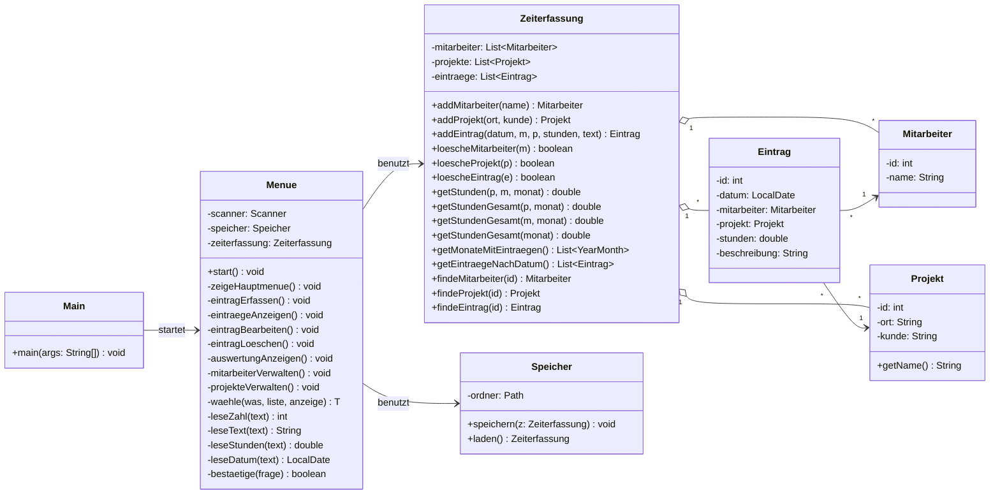

# Stundenbuch: Zeiterfassung als Java-Terminal-App

Diese Datei ist der Bauplan für Claude Code. Lies sie komplett, bevor du anfängst.

---

## 1. Ziel

Eine Java-Konsolenanwendung, mit der ein kleines Team erfasst, **wer wann wo an welchem Projekt wie viele Stunden** gearbeitet hat und **was** gemacht wurde.

- Die Stunden werden pro Projekt und pro Mitarbeiter addiert.
- Stunden eines Projekts dürfen **nie** bei einem anderen Projekt mitgezählt werden.
- Alles läuft im Terminal. Keine grafische Oberfläche, kein Swing, kein JavaFX.
- Menütexte, Code-Kommentare und Commit-Nachrichten sind auf **Deutsch**.

---

## 2. Arbeitsweise (WICHTIG)

Ich (der Nutzer) bin HTL-Schüler und will verstehen, was gebaut wird. Darum gilt:

1. **Arbeite Schritt für Schritt** nach dem Plan in Abschnitt 9. Immer nur **einen** Schritt auf einmal.
2. **Vor jedem Schritt:** Erkläre in 2 bis 4 Sätzen, was du jetzt baust und warum.
3. **Nach jedem Schritt** in dieser Reihenfolge:
   1. Mit `mvn -q package` kompilieren. Bei Fehlern: beheben, erst dann weiter.
   2. **Probelauf** machen (siehe Abschnitt 8) und mir die wichtigsten Zeilen der Ausgabe zeigen.
   3. Committen mit einer deutschen Nachricht, z. B. `Schritt 3: Speichern und Laden als CSV`.
   4. Auf GitHub pushen (`git push`).
   5. Kurz zusammenfassen: Was ist neu, was habe ich gelernt (1 bis 2 Konzepte erklären, z. B. "Warum Objekte statt Namen in Eintrag").
   6. **Stopp.** Warte, bis ich "weiter" schreibe.
4. Wenn etwas unklar ist oder du von diesem Plan abweichen willst: **frag mich zuerst**, rate nicht.
5. Keine externen Bibliotheken außer dem, was in Abschnitt 3 steht.

---

## 3. Technik

| Punkt | Vorgabe |
|---|---|
| Sprache | Java 17 (läuft auch mit neueren Versionen) |
| Build | Maven |
| groupId / artifactId | `stundenbuch` / `stundenbuch` |
| Version | `1.0` |
| Package | `stundenbuch` |
| Encoding | UTF-8 (`project.build.sourceEncoding`) |
| Ausführbare Jar | `maven-jar-plugin` mit `mainClass` = `stundenbuch.Main` |
| Ergebnis | `target/stundenbuch-1.0.jar`, startbar mit `java -jar` |
| Bibliotheken | keine |

### Git und GitHub
- Lege mit `git init` ein Repository an, falls noch keins existiert.
- `.gitignore`: `target/`, `dist/`, `.idea/`, `*.iml`, `.vscode/`, `testdaten/`
- Prüfe mit `git remote -v`, ob ein GitHub-Remote existiert. **Wenn nicht: frag mich nach der URL** und lege es mit `git remote add origin <URL>` an.
- Wenn `git push` fehlschlägt (z. B. Anmeldung): sag mir genau, was nicht geklappt hat, und mach nicht ohne Push weiter, bis ich entschieden habe.

---

## 4. Ordnerstruktur

```
stundenbuch/
├── pom.xml
├── README.md
├── .gitignore
├── build-exe.bat                  (erst in Schritt 9)
├── testeingaben/                  Eingaben für die Probeläufe
│   └── schritt5.txt ...
└── src/main/java/stundenbuch/
    ├── Main.java
    ├── Menue.java
    ├── Zeiterfassung.java
    ├── Speicher.java
    ├── Mitarbeiter.java
    ├── Projekt.java
    └── Eintrag.java
```

---

## 5. Klassen (UML)



### Aufgaben der Klassen

| Klasse | Aufgabe | Darf NICHT |
|---|---|---|
| `Main` | startet nur `new Menue(new Speicher()).start()` | sonst etwas tun |
| `Menue` | Ein- und Ausgabe im Terminal | rechnen oder Dateien schreiben |
| `Zeiterfassung` | hält die Listen, rechnet, prüft Regeln | `System.out` benutzen |
| `Speicher` | liest und schreibt CSV-Dateien | mit dem Benutzer reden |
| `Mitarbeiter`, `Projekt`, `Eintrag` | Datenklassen mit Konstruktor, Gettern, Settern für änderbare Felder | Logik enthalten |

Details zu den Datenklassen:
- `id` ist `final`, alles andere hat Setter (wegen Umbenennen und Eintrag bearbeiten).
- `Projekt.getName()` gibt `ort + "/" + kunde` zurück, z. B. `Graz/Mustermann`.
- `Eintrag` hält **Objekte** (`Mitarbeiter`, `Projekt`), keine Namen und keine IDs. So wirkt Umbenennen automatisch auf alle Einträge.
- `toString()` von `Mitarbeiter` und `Projekt` gibt den Namen zurück.

---

## 6. Menü und Funktionen

```
===== STUNDENBUCH =====
1) Eintrag erfassen
2) Arbeitstage anzeigen
3) Eintrag bearbeiten
4) Eintrag löschen
5) Auswertung (Stunden pro Projekt)
6) Mitarbeiter verwalten
7) Projekte verwalten
0) Speichern und beenden
Auswahl:
```

Beim Start: Daten laden und anzeigen, wo sie liegen (`Deine Daten liegen in: ...`).

### 1) Eintrag erfassen
Abfrage in dieser Reihenfolge:
1. Datum `TT.MM.JJJJ`, leere Eingabe = heute
2. Mitarbeiter aus nummerierter Liste (0 = abbrechen)
3. Projekt aus nummerierter Liste (0 = abbrechen)
4. Stunden, z. B. `4,5` oder `4.5`, erlaubt: größer 0 bis höchstens 24
5. Beschreibung "Was wurde gemacht?", darf nicht leer sein

Gibt es noch keinen Mitarbeiter oder kein Projekt: Hinweis ausgeben und zurück ins Hauptmenü.

### 2) Arbeitstage anzeigen
Gruppiert nach Tag, neuester Tag zuerst, mit Tagessumme. Beispiel:
```
Mo., 05.10.2026   (gesamt 15,0 h)
------------------------------------------------------------
  [#1] Jonas        Graz/Mustermann            10,0 h
        Konzept erstellt
  [#3] Lena         Wien/Huber                  5,0 h
        Datenbank aufgesetzt
```
Die Zahl nach `#` ist die Eintrags-ID und wird zum Bearbeiten und Löschen gebraucht.

### 3) Eintrag bearbeiten
1. Arbeitstage anzeigen, dann nach der `#`-Nummer fragen (0 = abbrechen).
2. Jedes Feld einzeln abfragen und den alten Wert in Klammern zeigen: `Stunden (alt: 10,0):`.
3. **Leere Eingabe = alten Wert behalten.** Für Mitarbeiter und Projekt: Liste zeigen, 0 = behalten.
4. Gleiche Prüfungen wie beim Erfassen.

### 4) Eintrag löschen
`#`-Nummer abfragen, dann bestätigen lassen: `Eintrag #2 (06.10.2026, Lena) wirklich löschen? (j/n)`.

### 5) Auswertung mit Monatsfilter
1. Zuerst den Zeitraum wählen:
   ```
   Zeitraum wählen:
     0) Gesamter Zeitraum
     1) Oktober 2026
     2) September 2026
   ```
   Es werden nur Monate angezeigt, in denen es Einträge gibt, neueste zuerst.
2. Dann die Tabelle: Zeilen = Projekte, Spalten = Mitarbeiter, dazu die Spalte `Gesamt` und die Zeile `Summe`:
   ```
   Auswertung: Oktober 2026
   Projekt               Jonas      Lena       Max    Gesamt
   ---------------------------------------------------------
   Graz/Mustermann      10,0 h    20,0 h     0,0 h    30,0 h
   Wien/Huber            5,0 h     0,0 h     0,0 h     5,0 h
   =========================================================
   Summe                15,0 h    20,0 h     0,0 h    35,0 h
   ```
3. Die Spaltenbreiten passen sich an den längsten Namen an. Zahlen sind rechtsbündig, mit Komma und einer Nachkommastelle (`Locale` de-AT).

Kernlogik in `Zeiterfassung`: Hier liegt das Gegenstück zu SUMIFS aus Excel. `monat == null` bedeutet "alle Monate":
```java
public double getStunden(Projekt p, Mitarbeiter m, YearMonth monat) {
    return eintraege.stream()
            .filter(e -> e.getProjekt() == p && e.getMitarbeiter() == m)
            .filter(e -> monat == null || YearMonth.from(e.getDatum()).equals(monat))
            .mapToDouble(Eintrag::getStunden)
            .sum();
}
```

### 6) Mitarbeiter verwalten und 7) Projekte verwalten
Untermenü mit Liste (Name + Gesamtstunden), darunter:
```
1) Hinzufügen   2) Umbenennen   3) Löschen   0) Zurück
```
- Projekte bestehen aus **Ort** und **Kunde**.
- Doppelte Namen sind nicht erlaubt (Groß-/Kleinschreibung egal).
- Löschen nur nach Bestätigung (j/n).

---

## 7. Regeln, Speicherung und Fehlerbehandlung

### Geschäftsregeln
- **Löschschutz:** Ein Mitarbeiter oder Projekt, der noch Einträge hat, darf nicht gelöscht werden. Meldung: `Geht nicht: Lena hat noch Einträge. Lösche diese zuerst.`
- **IDs:** Jede neue ID ist die bisher höchste ID + 1. IDs werden nie wiederverwendet oder geändert.
- **Automatisch speichern:** Nach **jeder** Änderung sofort speichern, nicht erst beim Beenden.

### Speicherung (CSV)
- Ordner: `System.getProperty("user.home")` + `/Stundenbuch`, also unter Windows z. B. `C:\Users\Name\Stundenbuch`. Ordner bei Bedarf anlegen.
- Drei Dateien, Trennzeichen `;`, Kodierung UTF-8, keine Kopfzeile:

| Datei | Spalten | Beispiel |
|---|---|---|
| `mitarbeiter.csv` | id;name | `1;Jonas` |
| `projekte.csv` | id;ort;kunde | `1;Graz;Mustermann` |
| `eintraege.csv` | id;datum;mitarbeiterId;projektId;stunden;beschreibung | `1;2026-10-05;1;1;10.0;Konzept erstellt` |

- Datum als ISO (`2026-10-05`), Stunden mit Punkt.
- In `eintraege.csv` stehen nur die **IDs**. Beim Laden über `findeMitarbeiter(id)` und `findeProjekt(id)` das passende Objekt suchen, damit alle Einträge auf **dasselbe** Objekt zeigen.
- **Escaping:** Ein `;` im Text würde die Spalten zerstören. Beim Schreiben `\` durch `\\` ersetzen und `;` durch `\s`, beim Lesen zurückwandeln.
- Fehlen die Dateien (erster Start), startet die App mit leeren Listen.
- Eine kaputte Zeile wird übersprungen, damit die App nicht abstürzt.
- Schlägt das Speichern fehl: Warnung ausgeben, nicht abstürzen.

### Eingaben
- Falsche Eingaben (Buchstaben statt Zahl, ungültiges Datum, Zahl außerhalb des Menüs) führen **nie** zum Absturz. Freundliche Meldung, dann neu fragen.
- Endet die Eingabe (`scanner.hasNextLine()` ist false, z. B. Strg+Z oder Ende der Testdatei): speichern und sauber beenden. Das ist wichtig für die Probeläufe.
- **Umlaute unter Windows:** Den Scanner mit der Kodierung der Konsole erstellen:
  ```java
  Console c = System.console();
  scanner = new Scanner(System.in, c != null ? c.charset() : Charset.defaultCharset());
  ```

---

## 8. Probelauf (Testen nach jedem Schritt)

Es gibt kein JUnit. Getestet wird durch einen **Probelauf**: Die App wird mit vorbereiteten Eingaben aus einer Textdatei gestartet.

- Lege für jeden Schritt eine Datei `testeingaben/schrittN.txt` an, eine Eingabe pro Zeile.
- **Nie mit meinen echten Daten testen.** Immer einen Testordner als Benutzerordner setzen:
  ```
  java -Duser.home=testdaten -jar target/stundenbuch-1.0.jar < testeingaben/schritt5.txt
  ```
  In PowerShell funktioniert `<` nicht, dort gilt:
  ```
  Get-Content testeingaben\schritt5.txt | java -Duser.home=testdaten -jar target\stundenbuch-1.0.jar
  ```
- Vor jedem Probelauf den Ordner `testdaten/` löschen, außer der Test prüft absichtlich das Laden nach einem Neustart.
- Jeder Probelauf soll auch **Falscheingaben** enthalten (z. B. `abc`, `99.99.2026`, `9` im Hauptmenü).
- In den Schritten 2 bis 4, solange es noch kein Menü gibt, darf `Main` vorübergehend Testcode enthalten. Ab Schritt 5 wird dieser Testcode entfernt.

### Abnahme am Ende (alles muss stimmen)
- [ ] 3 Mitarbeiter und 2 Projekte anlegen, dann 3 Einträge erfassen: Die Auswertung zeigt die richtigen Summen pro Projekt und Mitarbeiter.
- [ ] Stunden von Projekt A tauchen nie bei Projekt B auf.
- [ ] Der Monatsfilter zeigt nur die Stunden des gewählten Monats.
- [ ] Nach einem Neustart sind alle Daten wieder da.
- [ ] Ein umbenannter Mitarbeiter erscheint auch in alten Einträgen mit dem neuen Namen.
- [ ] Ein Mitarbeiter mit Einträgen kann nicht gelöscht werden.
- [ ] Beim Bearbeiten behält eine leere Eingabe den alten Wert.
- [ ] Eine Beschreibung mit `;` wird korrekt gespeichert und wieder geladen.
- [ ] Keine Falscheingabe bringt die App zum Absturz.

---

## 9. Bauplan Schritt für Schritt

Nach **jedem** Schritt: kompilieren, Probelauf, Commit, Push, erklären, **auf "weiter" warten** (siehe Abschnitt 2).

| Schritt | Inhalt | Probelauf prüft |
|---|---|---|
| 1 | Maven-Projekt, `pom.xml`, `.gitignore`, Git-Repo, GitHub-Remote, leere `Main` mit "Hallo Stundenbuch" | `java -jar` gibt den Text aus |
| 2 | Datenklassen `Mitarbeiter`, `Projekt`, `Eintrag` | `Main` legt testweise Objekte an und gibt sie aus |
| 3 | `Zeiterfassung` mit allen Listen, add/lösche/finde, Löschschutz, `getStunden` mit Monatsfilter | `Main` rechnet ein Beispiel: Projekt-Summen getrennt, Löschschutz greift |
| 4 | `Speicher`: CSV schreiben und laden, Escaping | Speichern, neu laden, Werte gleich (auch Text mit `;`) |
| 5 | `Menue`: Hauptmenü-Schleife und alle Eingabe-Hilfsmethoden, Testcode aus `Main` entfernen | Falscheingaben im Hauptmenü, 0 beendet sauber |
| 6 | Menüpunkte 6 und 7: Mitarbeiter und Projekte verwalten | anlegen, doppelt anlegen, umbenennen, löschen |
| 7 | Menüpunkte 1, 2 und 4: erfassen, anzeigen, löschen | Einträge erscheinen gruppiert nach Tag, Löschen mit j/n |
| 8 | Menüpunkt 3: Eintrag bearbeiten | leere Eingabe behält alten Wert, Änderung wird gespeichert |
| 9 | Menüpunkt 5: Auswertung mit Monatsfilter | Tabelle stimmt, Filter stimmt |
| 10 | `README.md`, Gesamt-Probelauf mit der Abnahme-Checkliste aus Abschnitt 8 | alle Haken gesetzt |
| 11 | `build-exe.bat` und .exe (Abschnitt 10) | `dist\Stundenbuch\Stundenbuch.exe` startet im Terminal |

---

## 10. .exe erstellen (Schritt 11)

Ziel: Andere Personen sollen die App **ohne installiertes Java** starten können. Dafür nutzt man `jpackage`, das ab Java 14 im JDK enthalten ist. Es packt die App zusammen mit einer eingebauten Java-Laufzeit in einen Ordner mit `Stundenbuch.exe`.

**Wichtig:** Eine Windows-.exe kann `jpackage` nur **auf Windows** bauen. Läuft Claude Code nicht auf Windows, nur `build-exe.bat` schreiben und mir erklären, wie ich sie ausführe.

Lege `build-exe.bat` im Projektordner an:
```bat
@echo off
echo [1/3] Baue die Jar ...
call mvn -q clean package || goto :fehler

echo [2/3] Bereite Dateien vor ...
if exist dist rmdir /s /q dist
mkdir target\jpackage-input
copy target\stundenbuch-1.0.jar target\jpackage-input\ >nul

echo [3/3] Erstelle Stundenbuch.exe ...
jpackage --type app-image ^
  --name Stundenbuch ^
  --input target\jpackage-input ^
  --main-jar stundenbuch-1.0.jar ^
  --main-class stundenbuch.Main ^
  --win-console ^
  --dest dist || goto :fehler

echo Fertig: dist\Stundenbuch\Stundenbuch.exe
pause
exit /b 0

:fehler
echo Es ist ein Fehler aufgetreten.
pause
exit /b 1
```

Dazu erklären:
- `--win-console` ist **Pflicht**. Ohne diese Option öffnet sich kein Terminalfenster, und die App ist unbedienbar.
- `--type app-image` erzeugt einen Ordner ohne Installer. Den ganzen Ordner `dist\Stundenbuch` weitergeben, z. B. als ZIP. Die .exe allein funktioniert nicht, weil sie den Ordner `runtime` daneben braucht.
- Ein echter Installer (`--type exe`) braucht zusätzlich das WiX Toolset. Das ist optional. Frag mich, ob ich das will.
- `dist/` steht in `.gitignore` und wird nicht committet.

---

## 11. README.md (Schritt 10)

Kurz und auf Deutsch:
- Was die App macht (2 Sätze)
- Voraussetzungen: JDK 17+, Maven
- Bauen: `mvn package`
- Starten: `java -jar target/stundenbuch-1.0.jar`
- Wo die Daten liegen
- Wie man die .exe baut (Verweis auf `build-exe.bat`)
- Die Klassen in einer kurzen Tabelle
